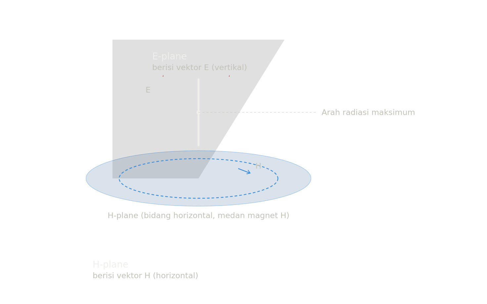

# 11 Parameter Kinerja Antena, Rumus, dan Gambar

Berikut penjelasan lengkap parameter-parameter kinerja antena yang paling umum dipelajari dalam sistem telekomunikasi, lengkap dengan rumus dan ilustrasi.
- ## 1. Pola Radiasi (Radiation Pattern)
  
  Gambaran grafis distribusi daya/medan yang dipancarkan antena terhadap arah (sudut θ, φ) pada jarak medan jauh (far field). Digambarkan dalam bentuk polar (2D) atau 3D.
- ## 2. Direktivitas (Directivity, D)
  
  Perbandingan intensitas radiasi pada arah tertentu (biasanya arah maksimum) terhadap intensitas radiasi rata-rata ke segala arah.
  
  $$D = \frac{4\pi , U_{max}}{P_{rad}}$$
  
  di mana $U_{max}$ = intensitas radiasi maksimum, $P_{rad}$ = daya total yang diradiasikan.
- ## 3. Penguatan (Gain, G)
  
  Mirip direktivitas, tapi memperhitungkan efisiensi antena (rugi-rugi ohmik).
  
  $$G = e_{rad} \times D$$
  
  Sering dinyatakan dalam dBi (relatif isotropis) atau dBd (relatif dipol setengah gelombang).
- ## 4. Efisiensi Antena (Radiation Efficiency, $e_{rad}$)
  
  Rasio daya yang benar-benar diradiasikan terhadap daya total input.
  
  $$e_{rad} = \frac{R_r}{R_r + R_L}$$
  
  $R_r$ = resistansi radiasi, $R_L$ = resistansi rugi (loss).
- ## 5. Impedansi Masukan (Input Impedance, $Z_{in}$)
  
  Impedansi yang "dilihat" pada terminal antena.
  
  $$Z_{in} = R_{in} + jX_{in}$$
  
  Bagian resistif $R_{in} = R_r + R_L$, bagian reaktif $X_{in}$ menyatakan energi tersimpan.
- ## 6. VSWR (Voltage Standing Wave Ratio) dan Return Loss
  
  Mengukur seberapa baik matching antara antena dan saluran transmisi.
  
  $$\Gamma = \frac{Z_{in}-Z_0}{Z_{in}+Z_0}, \quad VSWR = \frac{1+|\Gamma|}{1-|\Gamma|}$$
  
  $$RL(dB) = -20\log_{10}|\Gamma|$$
- ## 7. Bandwidth
  
  Rentang frekuensi di mana kinerja antena (biasanya VSWR ≤ 2 atau gain turun ≤ 3 dB) masih memenuhi spesifikasi.
  
  $$BW = \frac{f_H - f_L}{f_c} \times 100%$$
- ## 8. Lebar Berkas (Beamwidth) — HPBW & FNBW
- **HPBW (Half Power Beamwidth)**: sudut antara dua titik di mana daya turun menjadi setengah (−3 dB) dari puncak.
- **FNBW (First Null Beamwidth)**: sudut antara null pertama di kedua sisi lobus utama.
- ## 9. Level Lobus Samping (Side Lobe Level, SLL)
  
  Perbandingan (dalam dB) antara puncak lobus utama dengan puncak lobus samping terbesar.
  
  $$SLL(dB) = 20\log_{10}\left(\frac{E_{main}}{E_{side}}\right)$$
- ## 10. Rasio Depan–Belakang (Front-to-Back Ratio, FBR)
  
  Perbandingan intensitas radiasi arah depan (0°) terhadap arah belakang (180°).
  
  $$FBR(dB) = 10\log_{10}\left(\frac{P(0°)}{P(180°)}\right)$$
- ## 11. Polarisasi
  
  Orientasi vektor medan listrik terhadap waktu (linear, sirkular, atau eliptis), ditentukan oleh **Axial Ratio (AR)** untuk polarisasi eliptis/sirkular:
  
  $$AR = \frac{E_{major}}{E_{minor}}$$
  
  Sekarang mari kita lihat pola radiasi ini secara visual, dengan lobus utama, lobus samping, HPBW, dan rasio depan-belakang.Diagram di atas menunjukkan lobus utama (arah radiasi terkuat), lobus samping yang lebih kecil, dan lobus belakang. Rasio antara level lobus utama dengan lobus belakang inilah yang disebut Front-to-Back Ratio, sedangkan sudut antara dua titik −3 dB di sekitar lobus utama adalah HPBW.
- ## Apa itu E-plane dan H-plane?
  
  Kedua istilah ini adalah **bidang referensi (reference plane)** yang digunakan untuk menggambarkan pola radiasi antena secara 2D, karena pola radiasi sebenarnya bersifat 3D dan sulit divisualisasikan secara langsung.
  
  **E-plane (bidang E / bidang medan listrik)**
  adalah bidang yang berisi vektor medan listrik (E) dan arah radiasi maksimum antena. Bidang ini sejajar dengan arah polarisasi medan listrik yang dipancarkan antena.
  
  **H-plane (bidang H / bidang medan magnet)**
  adalah bidang yang berisi vektor medan magnet (H) dan arah radiasi maksimum antena. Bidang ini tegak lurus terhadap E-plane, namun tetap memuat arah radiasi maksimum yang sama.
  
  Karena gelombang elektromagnetik terdiri dari medan E dan medan H yang saling tegak lurus (dan keduanya tegak lurus terhadap arah rambat gelombang), maka E-plane dan H-plane juga selalu saling tegak lurus satu sama lain, keduanya berpotongan pada garis arah radiasi maksimum (boresight).
  
  Contoh paling mudah adalah antena dipol setengah gelombang (λ/2) yang berorientasi vertikal:
- Medan E terpolarisasi vertikal (sejajar dengan sumbu dipol) → **E-plane** adalah bidang vertikal yang memuat sumbu dipol.
- Medan H tegak lurus terhadap sumbu dipol → **H-plane** adalah bidang horizontal (azimuth) tegak lurus sumbu dipol.## Ringkasan pentingnya E-plane dan H-plane 
- Kedua bidang ini penting karena:
- **Karakterisasi pola radiasi 2D** — Datasheet antena biasanya menampilkan dua grafik pola radiasi: pola E-plane dan pola H-plane, karena pola 3D penuh sulit dibaca dalam bentuk angka/tabel.
- **Menentukan polarisasi** — Arah E-plane menunjukkan arah polarisasi gelombang yang dipancarkan, penting untuk pencocokan (matching) antara antena pemancar dan penerima.
- **Perhitungan beamwidth** — HPBW biasanya dihitung dan dilaporkan terpisah untuk E-plane dan H-plane, karena keduanya bisa berbeda nilai (misalnya antena patch/microstrip sering punya HPBW E-plane dan H-plane yang tidak sama, mencerminkan bentuk lobus yang tidak simetris/elips).
- **Desain array antena** — Saat menyusun elemen antena menjadi array, penempatan elemen relatif terhadap E-plane atau H-plane memengaruhi coupling antar elemen dan bentuk pola radiasi gabungan.
  
  Sebagai catatan praktis: pada antena isotropis ideal, tidak ada perbedaan E-plane/H-plane karena radiasinya sama ke segala arah — konsep ini baru relevan untuk antena riil yang punya arah polarisasi dan pola radiasi terarah, seperti dipol, horn, patch, atau antena Yagi.