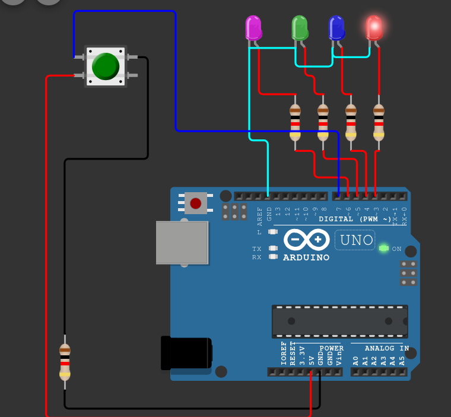

- 1.Buatlah LED menyala satu per satu sesuai urutan push button ditekan.
  2.Contoh: push button ditekan LED hijau menyala, push button ditekan lagi LED biru
  menyala namun LED hijau dan merah mati, dan seterusnya.
-
-
- berikut command nya
-
- #define LED_PINK 6
- #define LED_hijau 5
- #define LED_biru 4
- #define LED_merah 3
- #define tombol 7
- int status =0;
- void setup() {
- pinMode(LED_PINK,OUTPUT);
- pinMode(LED_hijau,OUTPUT);
- pinMode(LED_biru,OUTPUT);
- pinMode(LED_merah,OUTPUT);
- digitalWrite(LED_hijau,LOW);
- digitalWrite(LED_hijau,LOW);
- digitalWrite(LED_hijau,LOW);
- digitalWrite(LED_hijau,LOW);
- }
- void loop() {
- if(digitalRead(tombol)==HIGH){
- status++;
- delay(300);
- }
- if (status==1){
- digitalWrite(LED_PINK,LOW);
- digitalWrite(LED_hijau,LOW);
- digitalWrite(LED_biru,LOW);
- digitalWrite(LED_merah,HIGH);
- }
- else if (status==2){
- digitalWrite(LED_hijau,LOW);
- digitalWrite(LED_biru,HIGH);
- digitalWrite(LED_merah,LOW);
- digitalWrite(LED_PINK,LOW);
- }
- else if (status==3){
- digitalWrite(LED_merah,LOW);
- digitalWrite(LED_hijau,HIGH);
- digitalWrite(LED_biru,LOW);
- digitalWrite(LED_PINK,LOW);
- }
- else if (status==4){
- digitalWrite(LED_merah,LOW);
- digitalWrite(LED_hijau,LOW);
- digitalWrite(LED_biru,LOW);
- digitalWrite(LED_PINK,HIGH);
- status=0;
- }
- }
-
- berikut gambar rangkaianya
- {:height 224, :width 196}
-
-